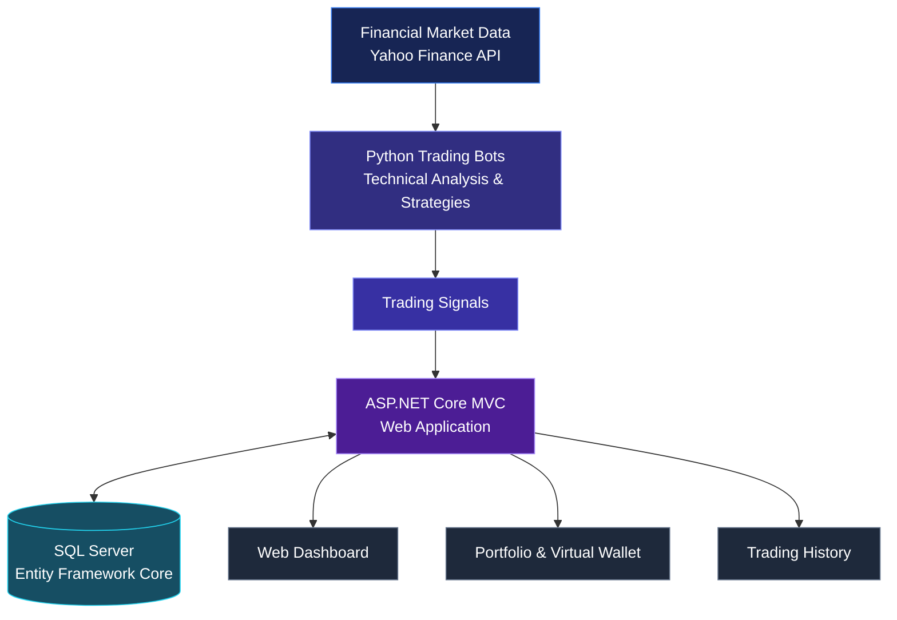

<div align="center">

# TradeCenter

### Algorithmic Trading & Portfolio Management Platform

A web-based algorithmic trading platform focused on Borsa Istanbul (BIST100) and cryptocurrency markets.

<br>


<br>

[](https://www.youtube.com/watch?v=tY1CumHahdU)

**Bachelor's Graduation Project · May 2025**

</div>

---

## What this does

TradeCenter is an algorithmic trading platform developed to support automated trading decisions in financial markets, with a particular focus on Borsa Istanbul (BIST100).

The project combines an ASP.NET Core MVC web application, Python-based trading bots, and a SQL Server database.

Trading decisions are generated using predefined technical indicators rather than machine learning models.

The platform provides a web interface for configuring trading strategies, monitoring automated trading activity, managing virtual wallets, and reviewing transaction history.

**Market Focus:** BIST100 and cryptocurrency markets  
**Trading Approach:** Rule-based algorithmic strategies  
**Trading Engine:** Python-based bots  
**Application:** ASP.NET Core MVC  
**Database:** Microsoft SQL Server  
**Validation:** Paper trading simulations  

---

## How the system works

TradeCenter consists of three main subsystems:

1. Data Subsystem
2. ASP.NET Core MVC Web Application
3. Python-Based Algorithmic Bot Worker



The Python workers retrieve market data, evaluate trading strategies, and generate trading signals.

The ASP.NET Core application processes these signals, manages application workflows, and updates trading records and virtual wallet balances.

SQL Server stores user information, financial assets, trading history, bot configurations, and wallet data.

---

## Core Features

| Component | Description |
|:---|:---|
| Algorithmic Trading | Python-based trading bots using technical indicators |
| Trading Strategies | RSI, Moving Averages, and volume analysis |
| Bot Configuration | User-defined investment amounts and strategy parameters |
| Risk Management | Stop-loss and take-profit settings |
| Portfolio Management | Virtual wallet balances and asset monitoring |
| Market Data | Financial data retrieval through Yahoo Finance |
| Trading History | Recording and displaying automated trading transactions |
| Price Alerts | User-defined price thresholds and notifications |
| Watchlist | Personalized financial asset tracking |
| Authentication | User registration, authentication, and two-factor authentication |
| Reporting | Transaction history and Excel export functionality |

---

## Technology Stack

| Category | Technologies |
|:---|:---|
| Backend | C#, ASP.NET Core MVC |
| Frontend | HTML, CSS, JavaScript, Razor Views |
| Database | Microsoft SQL Server |
| ORM | Entity Framework Core |
| Trading Algorithms | Python |
| Market Data | Yahoo Finance API, TradingView |
| Authentication | ASP.NET Core Identity |
| Email Services | SendGrid |
| Data Processing | Newtonsoft.Json |
| Excel Export | ClosedXML |
| Testing | Moq, Entity Framework In-Memory |
| Development Tools | Visual Studio 2022, Postman |

The frontend was developed using HTML, CSS, and JavaScript without an external frontend framework.

---

## Trading Strategies

TradeCenter implements rule-based algorithmic trading strategies.

Instead of using machine learning or artificial neural networks, trading decisions are based on predefined technical indicators.

### Relative Strength Index (RSI)

RSI is used to evaluate market conditions and generate trading signals according to configured strategy rules.

### Moving Averages

Moving Average indicators are used to analyze price trends and support automated trading decisions.

### Volume Analysis

Trading volume is included among the technical indicators considered by the system.

### Trading Workflow

```text
Market Data Retrieval
        |
        v
Technical Indicator Analysis
        |
        v
Strategy Evaluation
        |
        v
BUY / SELL / HOLD Signal
        |
        v
Trade Signal Processing
        |
        v
Database & Wallet Update
        |
        v
Dashboard & Trading History
```

Users can configure trading parameters, including investment amounts, strategy selection, stop-loss levels, and take-profit thresholds.

---

## Background Services

The application includes background services for processing trading signals, managing notifications, and maintaining user-related data.

| Service | Responsibility |
|:---|:---|
| AlertCheckService | Periodically checks active price alerts |
| BotSignalListenerService | Receives and processes trading signals from bots |
| IPriceAlertService | Evaluates price conditions and generates notifications |
| WalletService | Manages virtual wallet operations and balance updates |
| WalletHistoryService | Records daily wallet balance snapshots |
| UnverifiedUserCleanupService | Removes expired unverified user accounts |
| SendGridEmailSender | Handles asynchronous email delivery |

### Trading Signal Processing

The `BotSignalListenerService` receives trading signals through HTTP requests.

Incoming signals are queued for asynchronous processing.

The service parses JSON-formatted signals, records transactions in the database, and updates the corresponding virtual wallet balances.

### Price Monitoring

The `AlertCheckService` periodically evaluates active price alerts.

When a configured threshold is reached, the system generates notifications according to user preferences.

---

## Data Management

TradeCenter uses Microsoft SQL Server with Entity Framework Core for relational data management.

The database structure includes models for:

- User accounts and authentication
- Financial assets
- Trading bots
- Bot-generated transactions
- Virtual wallets
- Deposit and withdrawal history
- Daily balance records
- Price alerts
- User notifications
- Watchlists
- Payment and subscription records

Entity Framework Core is used to manage database operations and relationships between application entities.

---

## Security

The project includes security mechanisms for user authentication and account protection.

**ASP.NET Core Identity**

Handles user authentication, authorization, and account management.

**Two-Factor Authentication**

Provides an additional verification step for user accounts.

**Email Verification**

Supports account verification and password recovery through email integration.

**Token Expiration**

The project documentation specifies a 20-minute token validity policy.

**API Credential Protection**

The system documentation describes encrypted storage of API keys and external service credentials.

---

## Testing & Validation

TradeCenter was evaluated using functional testing, unit testing, integration testing, and paper trading simulations.

The testing process covered:

- Controllers, Models, ViewModels, and Services
- User authentication workflows
- Trading signal processing
- Wallet operations
- Database interactions
- Security and performance scenarios
- Automated trading behavior

Entity Framework In-Memory and Moq were used to isolate dependencies during testing.

### Paper Trading

Trading strategies were evaluated through paper trading simulations without using real money.

The experiments focused on verifying trading signals, transaction processing, database updates, and the behavior of automated trading strategies.

### Technical Limitations

The project identified limitations related to the frequency and availability of market data.

Yahoo Finance did not provide the second-level data required for the originally targeted high-frequency trading scenarios.

Additionally, API data limitations restricted access to some BIST100 stocks.

As a result, the project was presented as a functional algorithmic trading prototype rather than a fully implemented high-frequency trading system.

---

## Project Demonstration

A recorded demonstration of TradeCenter is available on YouTube.

<div align="center">

[](https://www.youtube.com/watch?v=tY1CumHahdU)

</div>

The project documentation includes application interfaces for:

- Login and authentication
- Portfolio and wallet dashboard
- Active trading bots
- Trading history
- Deposit and withdrawal operations
- Bot configuration
- Notifications
- Financial asset details
- Account and security settings

---

## Project Information

| | |
|:---|:---|
| Project | TradeCenter |
| Type | Bachelor's Graduation Project |
| Institution | Işık University |
| Completion | May 2025 |
| Academic Supervisor | Prof. Dr. Devrim Akça |

### Project Team

- Ebrar Albayrak
- Bilal Berkay Badanoz
- Osman Yener Işık

---

## Repository Information

This repository serves as a technical documentation and portfolio showcase for TradeCenter.

The original application source code is not publicly available in this repository.

The project documentation and recorded demonstration provide an overview of the implemented system, its architecture, technologies, and functionality.

---

<div align="center">

**TradeCenter · Algorithmic Trading & Portfolio Management**

*Bachelor's Graduation Project — 2025*

</div>
